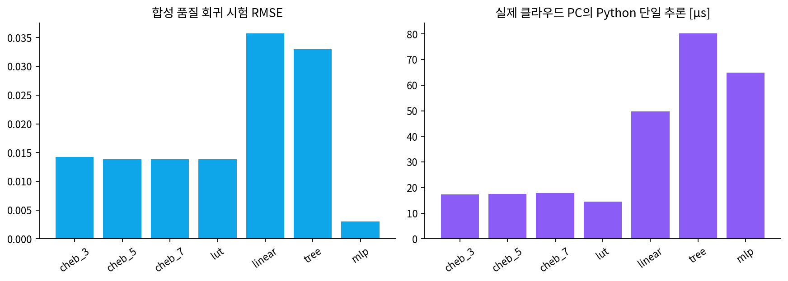
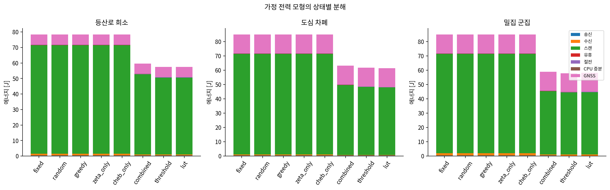
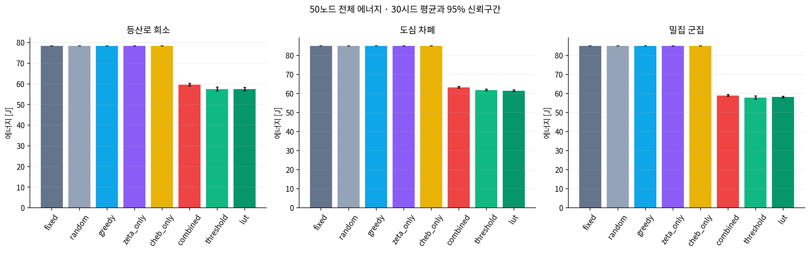
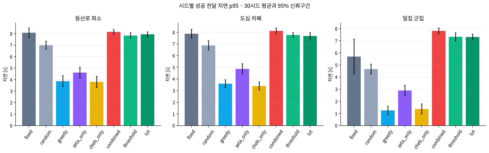
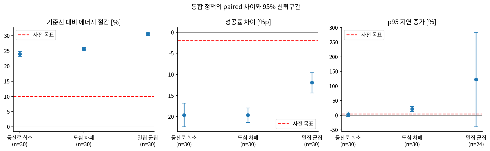
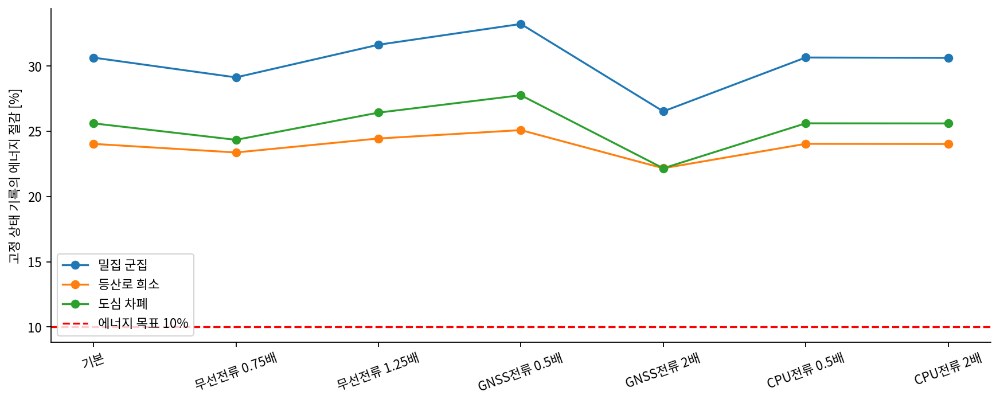
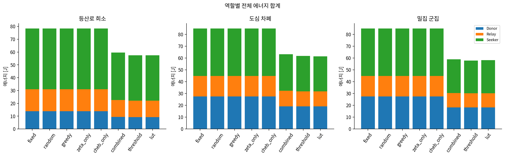
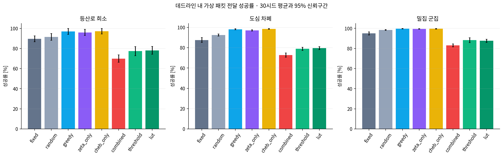

# ZetaMesh 50노드 시뮬레이션 검증 보고서

## 결론

전체 초기 성공 기준을 충족하지 못했다. 통합 정책의 복잡도 증가를 정당화할 근거가 없다. 이 결론은 아래 Linux 클라우드에서 실제 실행한 **가정 전력 기반 시뮬레이션**에 한정한다. Windows Ryzen 5 5600X와 ESP32-C3의 측정 결과는 없다.

## 문서 적용과 실행 환경

최신 사용자 요청 → 50노드 실행 명세 → 환경 가이드 순으로 적용했다. 가이드의 20/100노드 예시보다 요청의 3→10→50노드를 우선했다. 문서의 에이전트 지시는 요청된 구현·연구 범위 안에서만 적용했다.

실제 OS `Linux-6.18.57-x86_64-with-glibc2.41`, Python `3.11.17 (main, Oct 21 2026, 17:46:53) [Clang 23.1.3 ]`, CPU `AMD EPYC 9V74 80-Core Processor`. 보이는 논리 CPU 3개, cgroup CPU `200000 100000`, RAM 제한 `8589934592` bytes. 실제 평가 프로세스 2개. 연결 가능한 USB 시리얼 [], BLE 인터페이스 [], NVIDIA 장치 []. 대상 Windows PC의 4→6 프로세스·20~24GB 예산 시험은 수행하지 않았다. Python 3.11 Linux 의존성 설치·호환성 검사와 Windows 3.11 바이너리 의존성 해석은 성공했으나 Windows에서 직접 실행하지는 않았다.

| 실행 수 | 이벤트 수 | 전체 벽시계 s | 실행별 최대 RSS MiB | 프로세스 | 시뮬레이션 s/회 |
| --- | --- | --- | --- | --- | --- |
| 720 | 71502469 | 725.089 | 104.242 | 2 | 90 |

RAM은 실행 프로세스 RSS를 20ms 간격으로 표본화한 최댓값이다. 간격 사이의 순간 피크는 놓칠 수 있으며 전체 OS 최고 RAM 또는 5600X 메모리 사용량이 아니다. 프로세스별 기록에는 재사용된 인터프리터·캐시가 포함된다. 원자료의 code_version은 실행 코드 SHA256이고 source_snapshot.zip에 당시 소스를 보존했다. 평가 버전 `sha256:fec771606182f1af1b6815e6f6b67870be7dfa2e9a019888cffe772336bb0e4b`.

## 설계와 정책

50노드, 90초, 3개 고정 YAML, 정책 8개 × 독립 시드 30개 × 시나리오 3개 = 720회. warmup 10초, 요구 주기 16초, deadline 10초, 수명 24초, 수신 정보 허용 연령 15초, 홉 제한 4다. 요청 시작 시 유효 캐시도 성공이며 지연은 0초다. p95는 각 시드에서 **성공한 요청**의 지연 p95를 구한 뒤 30시드 평균을 낸 것이다. 실패를 deadline으로 대입한 p95와 실패율도 summary.csv에 따로 제공한다.

학습 100~103, 차수 선택 150, 근사 시험 160, 네트워크 튜닝 200~204, 본 평가 1000~1029를 분리했다. 기준선은 튜닝에서 fixed 대비 QoS를 지킨 fixed/random/greedy/threshold/lut 중 최저 에너지로 고정했다. reports/preregistration.json의 동결시각은 `2026-11-08 17:12:01 KST`, 본 평가 시작은 `2026-11-08 17:12:01 KST`로 초 단위 기록이다. 원시 JSON 로그는 UTC이며 본문은 한국 시간으로 표시했다. 동결 명령 종료 뒤 평가 명령을 순차 실행했고 평가 CLI는 동결 파일의 존재를 검사한 다음 실행 전 source_snapshot.zip에 그 파일을 포함했다. 초 단위 시각이 같은 경우에는 스냅샷의 동결 파일 내용 일치와 파일시각 나노초 순서도 검증했다. 기준선 선정 규칙과 10%·2%p·5% 기준은 evaluation_design_ko.md에 있다. 신뢰구간은 독립 시드의 paired 효과에 대한 Student t 구간이며 다중 비교 보정은 하지 않았다.

fixed는 ID 기준, random은 무작위, greedy는 단순 관측 점수 최대, zeta_only는 단순 점수의 제타 선택, cheb_only는 학습 체비쇼프 점수의 최대, combined는 체비쇼프·제타·적응 스케줄이다. threshold는 단순 점수와 로컬 fresh/요청 여부 임계값 스케줄, lut는 학습 가산형 LUT와 같은 스케줄을 쓴다. combined/threshold/lut의 적응 스케줄 구조는 같으므로 그 차이는 주로 선택 함수 차이다. 단독 제거 정책은 고정 스케줄이라 combined와의 차이를 제타·체비쇼프 효과로만 해석하지 않는다.

## 50노드 실제 실행 평균

전력·전압은 실측 전 가정이므로 J는 모형 추정치다. 역할별 비용은 역할에 속한 모든 노드의 합이다. 전체 지표별 95% 신뢰구간은 summary.csv에 있다.

| 시나리오 | 정책 | 전체 J | 성공률 % | p95 s | Donor J | Relay J | Seeker J |
| --- | --- | --- | --- | --- | --- | --- | --- |
| 등산로 희소 | fixed | 78.383 | 89.609 | 8.086 | 13.779 | 17.229 | 47.375 |
| 등산로 희소 | random | 78.383 | 91.563 | 6.997 | 13.779 | 17.229 | 47.375 |
| 등산로 희소 | greedy | 78.383 | 96.968 | 3.868 | 13.779 | 17.229 | 47.375 |
| 등산로 희소 | zeta_only | 78.383 | 96.018 | 4.616 | 13.779 | 17.229 | 47.375 |
| 등산로 희소 | cheb_only | 78.391 | 97.154 | 3.802 | 13.780 | 17.230 | 47.380 |
| 등산로 희소 | combined | 59.550 | 69.969 | 8.153 | 9.307 | 13.244 | 36.998 |
| 등산로 희소 | threshold | 57.467 | 77.389 | 7.838 | 9.283 | 12.797 | 35.387 |
| 등산로 희소 | lut | 57.462 | 78.159 | 7.932 | 9.282 | 12.792 | 35.388 |
| 도심 차폐 | fixed | 84.984 | 87.548 | 7.885 | 27.558 | 17.230 | 40.197 |
| 도심 차폐 | random | 84.984 | 92.423 | 6.886 | 27.558 | 17.230 | 40.196 |
| 도심 차폐 | greedy | 84.984 | 98.142 | 3.595 | 27.558 | 17.230 | 40.197 |
| 도심 차폐 | zeta_only | 84.984 | 97.071 | 4.874 | 27.558 | 17.230 | 40.197 |
| 도심 차폐 | cheb_only | 84.991 | 98.524 | 3.403 | 27.559 | 17.231 | 40.200 |
| 도심 차폐 | combined | 63.228 | 72.745 | 8.138 | 19.085 | 13.219 | 30.923 |
| 도심 차폐 | threshold | 61.810 | 78.870 | 7.777 | 19.039 | 12.769 | 30.001 |
| 도심 차폐 | lut | 61.454 | 79.589 | 7.696 | 19.020 | 12.730 | 29.704 |
| 밀집 군집 | fixed | 84.987 | 94.963 | 5.705 | 27.558 | 17.230 | 40.199 |
| 밀집 군집 | random | 84.987 | 98.410 | 4.662 | 27.558 | 17.230 | 40.199 |
| 밀집 군집 | greedy | 84.988 | 99.701 | 1.254 | 27.558 | 17.230 | 40.200 |
| 밀집 군집 | zeta_only | 84.988 | 99.479 | 2.894 | 27.558 | 17.230 | 40.199 |
| 밀집 군집 | cheb_only | 85.019 | 99.537 | 1.381 | 27.565 | 17.237 | 40.217 |
| 밀집 군집 | combined | 58.950 | 83.017 | 7.825 | 18.217 | 12.123 | 28.611 |
| 밀집 군집 | threshold | 57.933 | 88.278 | 7.331 | 18.215 | 11.915 | 27.803 |
| 밀집 군집 | lut | 58.131 | 87.597 | 7.312 | 18.215 | 11.905 | 28.011 |

## 사전 기준선 대비 paired 효과와 성공 판정

양의 에너지 절감은 개선, 양의 지연 증가는 악화다. 평균 paired 비율은 평균 에너지의 비율과 다를 수 있다. 세 조건 모두 점추정으로 만족한 경우와 95% 구간 전체가 경계를 통과한 경우를 구분했다.

| 시나리오 | 기준선 | 에너지 절감 % [95% CI] | 성공률 차이 %p [95% CI] | p95 증가 % [95% CI] | 상대 지연 유효 시드 | 점추정 충족 | CI 전체 충족 |
| --- | --- | --- | --- | --- | --- | --- | --- |
| 등산로 희소 | fixed | 24.03 [23.18, 24.88] | -19.64 [-22.43, -16.86] | 3.30 [-4.21, 10.81] | 30 | 아니오 | 아니오 |
| 도심 차폐 | random | 25.60 [25.06, 26.14] | -19.68 [-21.38, -17.97] | 21.37 [12.53, 30.20] | 30 | 아니오 | 아니오 |
| 밀집 군집 | fixed | 30.64 [30.12, 31.16] | -11.95 [-14.39, -9.50] | 122.25 [-39.37, 283.87] | 24 | 아니오 | 아니오 |

선택 기준선 이외의 모든 정책 차이도 paired_differences_raw.csv와 paired_summary.csv에 남겼다. 시나리오별 30개 시드가 통계 단위이며 수천 개 패킷을 독립 표본으로 부풀리지 않았다. 기준선 p95가 0초인 시드는 상대 변화율이 정의되지 않으므로 유효 시드 수를 표기하고 30개를 모두 평가할 수 없으면 지연 조건의 판정을 유보했다. 절대 p95 차이 [s]는 paired_summary.csv의 latency_delta_s에 별도로 제공한다. 위 표의 상대 지연 신뢰구간이 유효 시드 일부만 사용했다면 전체 30시드 구간으로 해석할 수 없다. 낮은 성공률 환경에 대한 절대 서비스 QoS 기준은 사전 정의하지 않아 실용성을 입증하지 않는다.

## 개별 정책과 단순 적응 정책 대비 통합의 실익

아래는 combined − 비교 정책의 paired 차이다. 에너지와 지연의 양수는 악화, 성공률의 양수는 개선이다. ablation_differences_raw.csv와 ablation_summary.csv에 원자료와 구간을 보존했다. 개별 선택 정책은 높은 전달률과 기본 스캔 비용을 보이며, 동일 적응 스케줄의 threshold/LUT 비교가 복잡도 실익을 평가한다. 단순 정책보다 총에너지·성공률·지연이 개선되지 않으면 통합 수학 구조를 추가할 근거로 삼지 않는다.

| 시나리오 | 통합과 비교할 정책 | 에너지 차이 J [95% CI] | 성공률 차이 %p [95% CI] | p95 차이 s [95% CI] |
| --- | --- | --- | --- | --- |
| 밀집 군집 | cheb_only | -26.068 [-26.510, -25.627] | -16.519 [-18.000, -15.038] | 6.444 [5.997, 6.892] |
| 밀집 군집 | lut | 0.819 [0.443, 1.195] | -4.580 [-6.374, -2.786] | 0.513 [0.144, 0.882] |
| 밀집 군집 | threshold | 1.017 [0.205, 1.829] | -5.261 [-7.699, -2.824] | 0.493 [0.091, 0.896] |
| 밀집 군집 | zeta_only | -26.038 [-26.479, -25.597] | -16.462 [-17.925, -14.999] | 4.931 [4.455, 5.407] |
| 등산로 희소 | cheb_only | -18.841 [-19.507, -18.175] | -27.185 [-29.283, -25.087] | 4.350 [3.774, 4.927] |
| 등산로 희소 | lut | 2.088 [1.690, 2.486] | -8.191 [-10.033, -6.348] | 0.221 [-0.040, 0.482] |
| 등산로 희소 | threshold | 2.083 [1.481, 2.685] | -7.421 [-9.724, -5.118] | 0.314 [0.051, 0.577] |
| 등산로 희소 | zeta_only | -18.833 [-19.499, -18.168] | -26.049 [-28.456, -23.643] | 3.537 [3.038, 4.036] |
| 도심 차폐 | cheb_only | -21.763 [-22.222, -21.304] | -25.779 [-27.742, -23.816] | 4.735 [4.275, 5.194] |
| 도심 차폐 | lut | 1.773 [1.464, 2.082] | -6.844 [-8.552, -5.136] | 0.442 [0.141, 0.743] |
| 도심 차폐 | threshold | 1.418 [1.054, 1.781] | -6.125 [-7.894, -4.356] | 0.361 [0.077, 0.645] |
| 도심 차폐 | zeta_only | -21.757 [-22.216, -21.298] | -24.326 [-26.209, -22.443] | 3.264 [2.706, 3.821] |

## 에너지 모델과 실패 원인 점검

E=V×I×시간. 전압 3.3V, TX 18mA, RX/scan 16mA, idle 1mA, sleep 0.02mA, CPU 추가 6mA, GNSS 독립 모듈 25mA를 가정했다. TX>RX>scan>idle>sleep으로 시간 구간을 한 상태에만 계상한다. RX 중 스캔 전류를 다시 더하지 않는다. CPU는 기저 상태에 대한 **증분** 전류이며 결정당 80μs와 후보별 단순 1μs·체비쇼프 6μs·LUT 2μs를 가정했다. 이 CPU 시간은 MCU 실측도 PC 벤치마크 시간도 아니다. GNSS는 Donor에서만 생성 주기마다 2초 작동하는 고정 비용이다. 배터리 소진과 부하별 전압 하강은 모델링하지 않았다.

모든 시나리오와 시드의 정책별 평균 상태 비용 [J]:

| policy | tx_j | rx_j | scan_j | idle_j | sleep_j | cpu_j | gnss_j |
| --- | --- | --- | --- | --- | --- | --- | --- |
| fixed | 0.375 | 1.172 | 69.937 | 0.081 | 0.206 | 0.015 | 11.000 |
| random | 0.375 | 1.172 | 69.937 | 0.081 | 0.206 | 0.014 | 11.000 |
| greedy | 0.375 | 1.172 | 69.937 | 0.081 | 0.206 | 0.015 | 11.000 |
| zeta_only | 0.375 | 1.172 | 69.937 | 0.081 | 0.206 | 0.015 | 11.000 |
| cheb_only | 0.375 | 1.172 | 69.937 | 0.081 | 0.206 | 0.030 | 11.000 |
| combined | 0.283 | 0.610 | 48.354 | 0.075 | 0.234 | 0.020 | 11.000 |
| threshold | 0.277 | 0.584 | 46.886 | 0.075 | 0.236 | 0.013 | 11.000 |
| lut | 0.276 | 0.583 | 46.831 | 0.075 | 0.236 | 0.015 | 11.000 |

주기적 스캔 비용과 Donor GNSS 고정 비용을 먼저 확인하고, TTL 24초/최대 연령 15초의 갱신 제한을 따로 점검했다. 데이터는 수신한 parent 후보에서만 채택하므로 순위 탐색·캐시 지연이 정보 전파를 늦출 수 있다. 동일 적응 스케줄의 단순 threshold/LUT보다 유의한 이득이 없으면 체비쇼프나 RL을 더 복잡하게 만드는 근거가 없다. CPU 추론 경량화 수치를 전체 무선/GNSS 절감률로 바꾸어 쓰지 않는다.

power_sensitivity.csv는 같은 상태 시간 기록에서 무선 전류 0.75/1.25배, GNSS 0.5/2배, CPU 0.5/2배를 적용한 재계산이다. 공통 전압 ±10%는 모든 에너지에 같은 비율을 곱하므로 절감률 순위는 같다. 전류 변경 시 정책·배터리 관측 반응까지 재실행한 결과는 아니다. network_sensitivity.csv는 donor 비율·패킷 수명·차폐 손실을 한 번에 하나씩 바꾼 별도 50노드/5시드 시험이다. 본 평가의 30시드 결과와 합치지 않았다.

## 학습된 품질 함수와 PC 추론

합성 예상 유용도 목표를 12,000개 특징에서 회귀하고, 3,000개 검증으로 5차를 선택했으며 별도 3,000개에서 시험했다. 입력은 수신 RSSI·보고 배터리·정보 연령·홉 수·RSSI 기반 링크 추정·보고 GNSS 품질이다. [-1,1] 정규화, 결측 기본값, 범위 clipping, 가산형 체비쇼프 성분과 15개 쌍별 상호작용항을 썼다. T3 양자화 코덱을 사용하지 않았다. 추론은 Clenshaw 방식이다. LUT는 같은 학습 가산 함수를 특징별 33개 격자로 저장하며 선형 보간한다. 이 합성 목표가 실제 GNSS 정보의 유용도를 보장하지 않는다.

| 모델 | MAE | RMSE | 최대 오차 | PC 추론 μs | 계수 bytes |
| --- | --- | --- | --- | --- | --- |
| cheb_3 | 0.009452 | 0.014265 | 0.169349 | 17.306190 | 272.000000 |
| cheb_5 | 0.009116 | 0.013848 | 0.167461 | 17.479287 | 368.000000 |
| cheb_7 | 0.009121 | 0.013867 | 0.167635 | 17.774363 | 464.000000 |
| lut | 0.009112 | 0.013853 | 0.167440 | 14.591087 | 1712.000000 |
| linear | 0.023842 | 0.035746 | 0.374708 | 49.809883 | 미정 |
| tree | 0.022816 | 0.033001 | 0.221594 | 80.234337 | 미정 |
| mlp | 0.002201 | 0.003021 | 0.031131 | 64.903430 | 미정 |

이 환경의 Python 단일 추론에서 체비쇼프 5차는 MLP 대비 73.1% 짧았고, LUT는 14.59μs였다. MLP의 RMSE 0.003021와 체비쇼프 0.013848의 정확도 차이도 함께 보아야 한다. 라이브러리 호출 비용을 포함한 Python 비교이므로 최적화된 C 선형모델·MCU 속도 순위로 일반화할 수 없다. models/inference_timing_raw.csv는 300회씩 5반복한 원시 시간이다. 계수 bytes는 float64 배열 크기이며 ESP32 Flash·스택·추론 에너지는 측정하지 않았다. Python 할당 피크와 pickle 크기도 MCU 메모리 대신 쓸 수 없다.

## 물리 모형과 관측 제약

광고·3개 채널별 송신/종료·스캔창·충돌·수신·중계·절전·만료·요청 deadline을 이벤트로 처리했다. 수신하려면 같은 채널에서 프레임 전체가 스캔창에 포함되어야 한다. 송신 중 수신은 불가능하다. 겹치는 감지 가능 프레임은 보수적으로 모두 충돌 처리하며 캡처 효과는 생략한다. 경로손실·NLOS 손실·1초 음영과 외부 간섭을 포함한다. 산악은 경로를 따라 긴 간격과 단절·저속 이동, 도심은 차폐·다양한 이동, 밀집은 3개 근접 군집이다. max_range는 추가 수신 차단 상한이며 수학적 정책이 늘리지 않는다.

파형·다중경로 지연·주파수별 안테나·연결형 BLE ACK/재전송·Wi-Fi 상세 파형·펌웨어 RTOS 지연·온도·보드 전원회로는 생략했다. 전파 지도는 정책별 독립 재생성이 아니라 같은 시각/공간 난수장이다. 시간 및 공간을 보간하는 정밀 RF 시뮬레이터가 아니다. JSON 패킷은 논리 데이터 모형이며 31-byte legacy 광고의 실제 바이너리 포맷·단편화·암호 인증을 검증하지 않았다. airtime 376μs는 고정 모형 가정이다. 실제 메타데이터 인코딩 오버헤드가 추가되면 airtime 보정이 필요하다.

광고 수신 후 이웃 메타데이터만 캐시한다. 최초 발견 전에는 공통 scan/adv를 사용하며 제타는 유효하게 수신한 후보에만 적용된다. 좌표·미발견 노드의 배터리·링크 행렬을 정책에 주지 않는다. 전체 방송 프레임의 RX 비용은 이미 지불한 뒤 사전에 선택한 parent의 데이터만 채택하므로 후보 선택이 수신 RF 에너지를 마법처럼 없애지 않는다. checksum은 오류 검출용이며 악의적 위변조 인증이 아니다. 사용자 위치를 포함한 실측 데이터는 수집하지 않았다.

## 재현 명령과 증거

README.md의 Windows 네이티브 명령 및 logs/의 실제 Linux 실행 기록을 참고한다. 3노드→10노드 fixed 시험, 핵심 pytest 26개 통과, 모델 학습/비교, 120회 튜닝 뒤 기준선 동결, 720회 본 평가, 90회 네트워크 민감도 시험을 수행했다. 각 실행의 manifest.json에 설정 전문·시드·코드 버전·실제 환경·프로세스 수를, runs.csv에 시간·이벤트 수·RSS를 남겼다. outputs/evaluation/requests.csv는 요청별 원자료, nodes.csv는 노드별 에너지다. source_snapshot.zip은 실행 당시 소스다.

## 실측 결과와 미실행 항목

실물 측정 결과는 없다. Windows 5600X의 실제 속도·RAM·4/6 프로세스 비교, ESP32-C3 Flash/RAM·전력·RF 실측, 실제 A-GNSS 주입·TTFF, 표준 Bluetooth Mesh 상호운용은 미검증이다. RL teacher와 증류도 후속 단계로 남겼다. 실행 실패 때문에 숨겨진 실험 결과는 없으며, 하드웨어 접근 부재로 이 항목들을 수행하지 못했다. 예시나 예상 수치를 실험 결과로 섞지 않았다.

## 다음 실물 검증

1. 보유 ESP32-C3 3대에 Donor/Relay/Seeker를 배치해 A→C 직접 링크가 실패하고 A→B→C에서 가상 패킷이 도착하는지 같은 송신전력으로 확인한다.
2. 광고 바이너리 인코딩·버전·중복/홉/만료·오류 처리를 ESP-IDF에서 구현한 뒤 채널별 로그와 RTT가 아닌 단방향 시각 동기화 지연을 기록한다. 이는 자체 BLE 중계 프로토콜이며 Bluetooth Mesh 표준 구현이 아니다.
3. 새 장비 구매를 전제하지 않고 사용 가능한 계측기로 상태별 평균 전류와 GNSS 활성 시간을 측정한다. INA219 평균값만으로 짧은 RF 피크를 입증하지 않는다. 계측기가 없으면 미측정으로 남긴다.
4. Windows 5600X에서 아래 재개 명령으로 4프로세스를 먼저 실행하고 RAM 여유를 확인한 뒤 6프로세스와 동일 시드를 비교한다. 실측값으로 전력·패킷 airtime·링크 모형을 보정한 다음 사전 설계를 새로 동결한다.
5. 실제 수신기가 지원하는 보조정보 포맷과 주입 API를 확인한 뒤에만 TTFF 실험을 별도로 설계한다. 중계 범위 확장을 단일 홉 RF 거리 증가 또는 GNSS TTFF 단축으로 표현하지 않는다.

```powershell
.\.venv\Scripts\python.exe -m pytest -q
.\.venv\Scripts\python.exe -m scripts.run_experiment --phase evaluation --seeds 30 --seed-start 1000 --workers 4 --out outputs/windows4
.\.venv\Scripts\python.exe -m scripts.run_experiment --phase evaluation --seeds 30 --seed-start 1000 --workers 6 --out outputs/windows6
```

## 그림

















